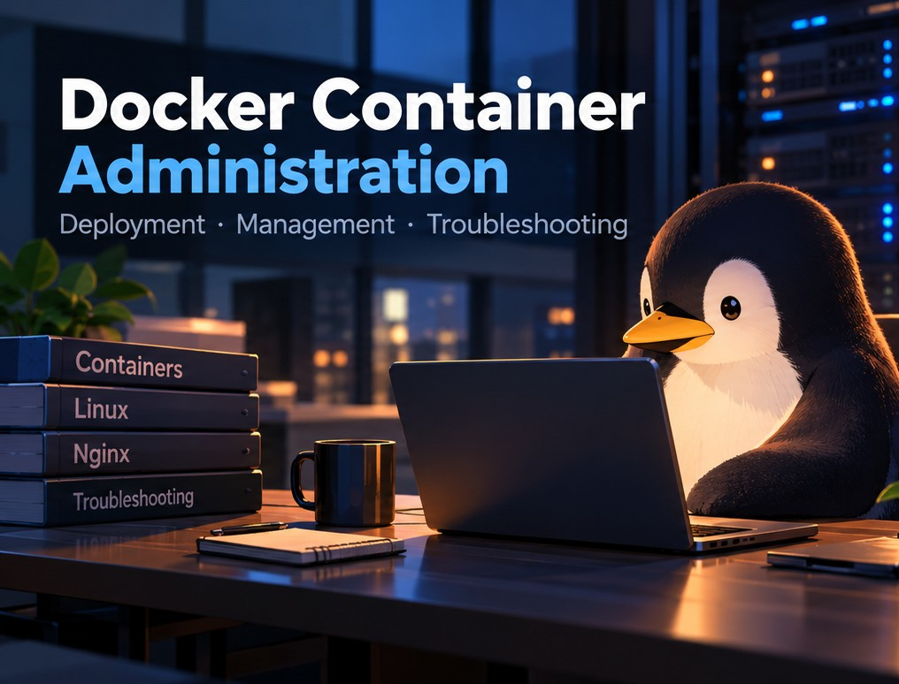
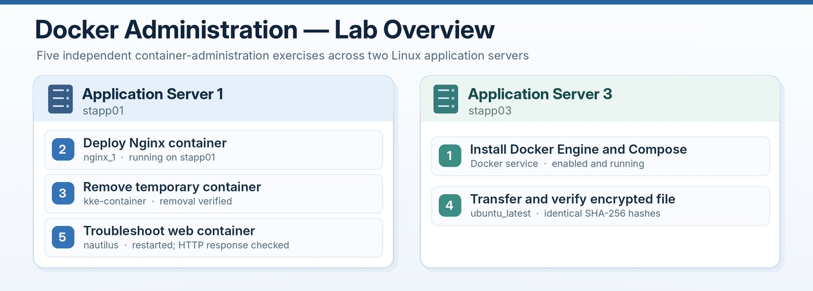
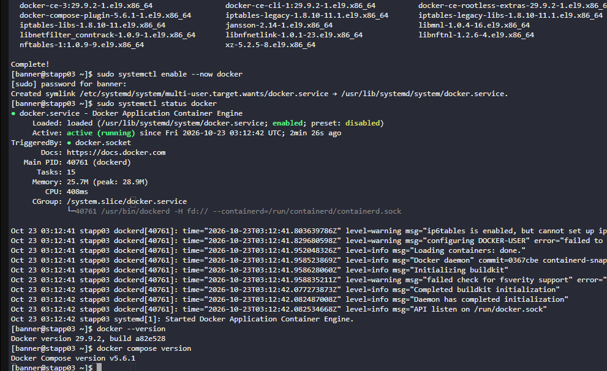
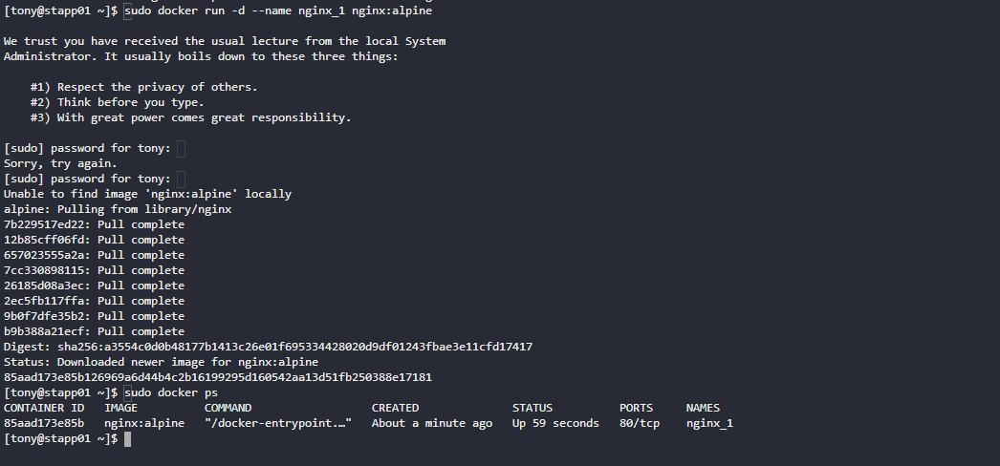
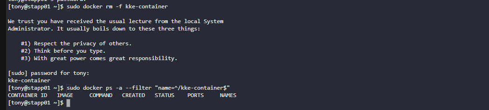
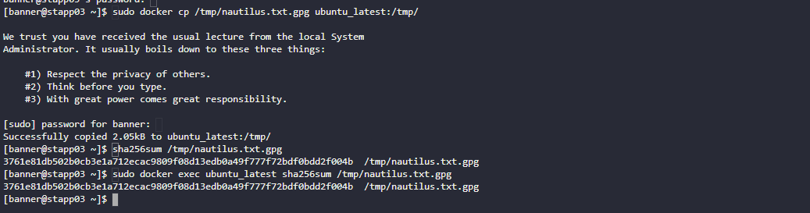
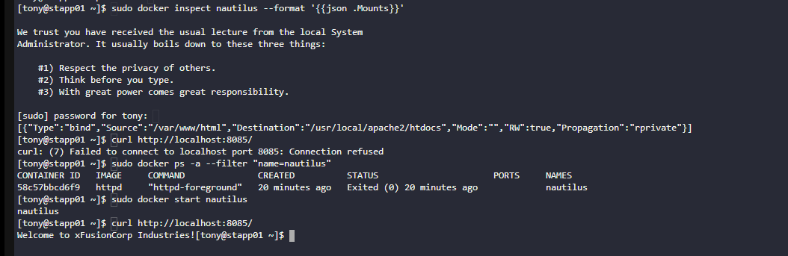

# Docker Container Administration

**Deployment, Management, File Integrity, and Troubleshooting on Linux**  
KodeKloud — Nautilus DevOps hands-on labs



## Project Overview

I completed five Docker administration labs in the Nautilus DevOps training environment. The work covered preparing a Linux server for containers, deploying an Nginx web server, removing an unused container, transferring a file into a running container, and recovering a stopped application container.

The common business need was straightforward: application servers must be ready to run containers, and administrators need to manage those containers safely after deployment. Instead of only running commands, I checked the resulting service state, container inventory, file integrity, or HTTP response where the lab provided a way to verify it.

**These were five separate operational exercises, not one integrated application deployment.**

**Technologies:** Linux (CentOS Stream 9) · Docker Engine · Docker Compose plugin · Nginx · Docker CLI · SSH · SHA-256 · `systemctl` · `curl`

---

## Lab Environment

| System | Work performed |
|---|---|
| `stapp03` — Application Server 3 | Docker installation and service configuration; encrypted file transfer into `ubuntu_latest` |
| `stapp01` — Application Server 1 | Nginx container deployment; temporary container removal; application-container troubleshooting |
| Jump host | SSH access to the application servers |



*The diagram shows how the exercises were grouped. The screenshots below are from the actual terminal sessions. The wider Nautilus environment included other servers, but I did not deploy a combined multi-server container application.*

## 1. Install and Configure Docker

**Scenario:** The DevOps team needed Docker Engine and Docker Compose available on a CentOS Stream 9 application server before container testing could begin.

On `stapp03`, I configured Docker's repository and installed the container runtime and supporting tools. I then enabled the Docker service and started it immediately.

```bash
sudo dnf install -y dnf-plugins-core
sudo dnf config-manager --add-repo https://download.docker.com/linux/centos/docker-ce.repo
sudo dnf install -y docker-ce docker-ce-cli containerd.io docker-buildx-plugin docker-compose-plugin
sudo systemctl enable --now docker
```

I checked the service and installed command-line tools:

```bash
sudo systemctl status docker
docker --version
docker compose version
```



**Verified result:** `docker.service` was **active (running)** and enabled to start with the system. The installed commands reported **Docker Engine 29.9.2** and **Docker Compose 5.6.1**.

The main takeaway was that installing a package isn't the same as confirming its service is available. Checking `systemctl` and the CLI versions provided evidence that the server was prepared for later container operations. Compose was installed, but this exercise did **not** deploy a multi-container Compose application.

## 2. Deploy an Nginx Container

**Scenario:** Nautilus needed an Nginx container running on `stapp01` for web-server deployment testing.

I launched an Nginx container using the lightweight Alpine-based image, gave it an explicit name, and ran it in detached mode:

```bash
sudo docker run -d --name nginx_1 nginx:alpine
sudo docker ps
```

Docker pulled the image because it was not already available locally. The `docker ps` output showed the container named `nginx_1` running from `nginx:alpine`.



**Verified result:** `nginx_1` was **Up 59 seconds**, with `80/tcp` shown in the container's ports column.

That output confirms the container was running and exposes port 80 **inside** the container. This command did not publish a host port with `-p`, so I am not treating this screenshot as proof that the Nginx site could be reached from outside the container.

## 3. Remove an Unused Container

**Scenario:** A temporary container named `kke-container` was no longer required on `stapp01`.

I removed it, then checked the full container inventory (including stopped containers) using an exact-name filter:

```bash
sudo docker rm -f kke-container
sudo docker ps -a --filter "name=^/kke-container$"
```



**Verified result:** Docker returned the container name after removal, and the filtered list contained no matching container.

The `-f` option can force a running container to stop before removal, so I would not use it casually on an unknown production workload. Here, the lab explicitly required deleting the temporary container. The important verification was checking that it was actually gone, not just assuming the removal command worked.

## 4. Copy a File and Verify Integrity

**Scenario:** The team needed an encrypted file copied from the Linux host on `stapp03` into an existing Ubuntu container without changing its contents.

I copied `nautilus.txt.gpg` to the container's `/tmp/` directory and compared SHA-256 hashes on both sides:

```bash
sudo docker cp /tmp/nautilus.txt.gpg ubuntu_latest:/tmp/
sha256sum /tmp/nautilus.txt.gpg
sudo docker exec ubuntu_latest sha256sum /tmp/nautilus.txt.gpg
```



**Verified result:** Docker reported **2.05 KB copied**, and the source and container copies produced **identical SHA-256 hashes**.

`docker cp` moves the file into the container; `docker exec` allowed me to run the checksum command inside it. Comparing hashes was useful because a successful copy message alone does not verify that both files have the same contents. The lab tested integrity of the encrypted file, not decryption or application processing.

## 5. Troubleshoot a Stopped Application Container

**Scenario:** The Nautilus application served through the `nautilus` container was not responding on `localhost:8085` on `stapp01`.

I inspected the container's mount configuration, tested the local HTTP endpoint, and checked its state:

```bash
sudo docker inspect nautilus --format '{{json .Mounts}}'
curl http://localhost:8085/
sudo docker ps -a --filter "name=nautilus"
```

The mount output showed a bind mount from `/var/www/html` on the host to `/usr/local/apache2/htdocs` in the container. The HTTP request returned **connection refused**, while `docker ps -a` showed that `nautilus` was **Exited (0)**.

I started the existing container and repeated the request:

```bash
sudo docker start nautilus
curl http://localhost:8085/
```



**Verified result:** After the start command, the endpoint returned **“Welcome to XFusionCorp Industries!”**

This established that the stopped container was preventing the tested service from responding and that starting it restored the HTTP response. The screenshot does **not** establish why the container had exited originally, so I would investigate logs and its restart policy before claiming a permanent fix.

---

## Results and Operational Value

| Exercise | Verified outcome |
|---|---|
| Docker installation | Engine and Compose installed; Docker service running and enabled |
| Nginx deployment | `nginx_1` running from the `nginx:alpine` image |
| Container cleanup | `kke-container` removed; no matching container in follow-up check |
| File transfer | Encrypted file copied; SHA-256 hashes matched |
| Container troubleshooting | Stopped `nautilus` identified; HTTP endpoint responded after starting it |

Together, these labs demonstrated everyday Linux container administration: preparing a host, managing container state, inspecting configuration, verifying data transfer, and responding to an unavailable service.

They also reinforced a consistent habit: **verify the outcome using a relevant check**—service status, `docker ps`, a checksum, or an HTTP request—rather than relying only on a command's exit message.

## What I Took Away

Docker makes it easier to run applications in isolated containers, but it does not remove the need for Linux administration and troubleshooting. The container may be healthy while its host port is unpublished, or a valid container configuration may still be unavailable because the container is stopped.

I also learned that different tasks call for different checks. `docker ps` was enough to confirm a running Nginx container, but matching file hashes required commands on both the host and inside the Ubuntu container. In the final exercise, inspecting mounts and checking the exited state helped narrow down why the local service wasn't responding.

**Scope:** These exercises did not implement production orchestration, a deployed Compose stack, high availability, or long-term monitoring.

**Skills practiced:** Linux Administration · Docker Engine · Docker CLI · Docker Compose Installation · Nginx Containers · Container Lifecycle · File Transfer · SHA-256 Integrity Verification · Bind Mount Inspection · HTTP Troubleshooting